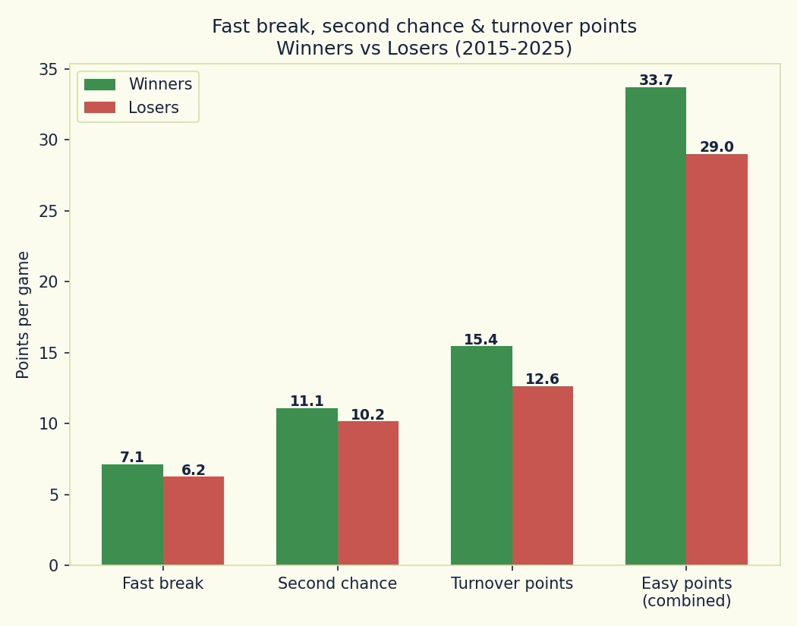
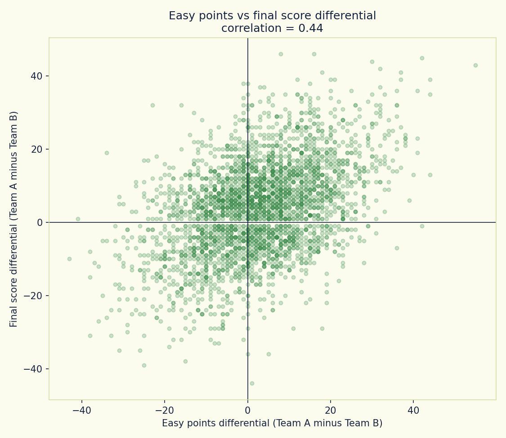

# Easy Points: do fast breaks, second chances and turnovers win games?

A team-level analysis of EuroLeague box score data (2015-16 to 2025-26) testing whether the team that scores more "easy points" (fast break, second chance and turnover points) tends to win the game.

**Brief report:** [open the report](https://htmlpreview.github.io/?https://github.com/viare21/euroleague-easy-points/blob/main/report.html)

## Results in brief

1. Winners score 33.68 easy points per game against 29.01 for losers. The largest gap is in turnover points (+2.82), then second chance (+0.94) and fast break (+0.90).
2. The team with more easy points wins 64.4% of games (3,135 games, 163 ties excluded).
3. The correlation between easy points differential and final score differential is 0.44. With fast break and second chance points only it was 0.27.

## Data

Source: [Euroleague & Eurocup Datasets](https://www.kaggle.com/datasets/babissamothrakis/euroleague-datasets) (Kaggle). Seasons `E2015` to `E2025`, 3,298 games.

| File | Columns used |
|---|---|
| `euroleague_comparison.csv` | `game_id`, `season_code`, `fast_break_points_a/b`, `second_chance_points_a/b`, `turnover_points_a/b` |
| `euroleague_header.csv` | `game_id`, `season_code`, `team_id_a/b`, `score_a/b` |

`a` and `b` are the two teams of a game, as stored in the source files.

## Project structure

| File | Role |
|---|---|
| `fastbreak_second_chance_analysis.py` | Main script: builds the metric, computes the statistics and saves the two charts |
| `images/` | Output charts (created by the script if missing) |
| `report.html` | Brief report with the narrative and the findings |

The data files are not included in the repository. They are read from a `csv_euroleague` folder placed next to the project folder.

## How it works

The script is organised in numbered sections, run top to bottom.

1. **Paths and load (0, 1).** Paths are relative to the script, so the project runs on any machine. Both CSVs are loaded in full.
2. **Games in scope (2).** Games are taken from the header, filtered on `E2015`-`E2025`. The winner is the team with the higher score. Overtime games are included, since the final score is used.
3. **Easy points (3).** For each team and game:

   `easy_points = fast_break_points + second_chance_points + turnover_points`

   The three components are taken from `euroleague_comparison.csv`, which already reports them per team per game.
4. **Long format (4).** Each game becomes two rows (one per team), with a Win/Loss flag. This makes it simple to average by result.
5. **Winners vs losers (5).** Mean of each component and of the total, grouped by result.
6. **Leader win rate (6).** For each game the "easy points leader" is the team with more easy points. Games with equal easy points have no leader and are excluded (163 games). The win rate is the share of games in which the leader also won.
7. **Correlation (7).** Per game:

   `easy_points_diff = easy_points_a - easy_points_b`
   `final_score_diff = score_a - score_b`

   The Pearson correlation between the two is reported. Swapping the two teams flips the sign of both differentials, so the correlation does not depend on which team is called A.
8. **Charts (8, 9).** A grouped bar chart (winners vs losers) and a scatter plot (one point per game).

### Design choices

- Turnover points are included because the first version, with fast break and second chance only, gave a weak relationship (correlation 0.27). Adding them raised it to 0.44, so the final metric uses all three.
- The three categories may overlap (a fast break can follow a turnover). The components are summed as reported, without checking for double counting, so the combined figure is a descriptive total and not a count of distinct points.
- Ties are excluded from the leader win rate rather than counted as half a win, to keep the figure easy to read as "the leader wins X% of the time".

## Data quality checks

- Section 3.1 counts missing values in the six columns, overall and by season. No missing values were found in any season of the scope, so older seasons are not patchier than recent ones.
- The number of games in scope is printed at the start (3,298).
- The number of ties excluded from the leader win rate is printed next to the result (163).

## Outputs

`images/winners_vs_losers_easy_points.png`: average points per game by component, winners vs losers.

| | Fast break | Second chance | Turnover points | Easy points |
|---|---|---|---|---|
| Winners | 7.14 | 11.09 | 15.44 | 33.68 |
| Losers | 6.24 | 10.15 | 12.62 | 29.01 |

`images/easy_points_vs_score_diff_scatter.png`: one point per game, easy points differential against final score differential, with the correlation in the title.

## How to run

1. Download the dataset from Kaggle and place `euroleague_comparison.csv` and `euroleague_header.csv` in a folder named `csv_euroleague`, one level above this project's folder.
2. Install the requirements: `pip install pandas matplotlib`
3. Run `fastbreak_second_chance_analysis.py`.

In Spyder, press F5 to run the whole file. Running cell by cell (F9) also works: if `__file__` is not defined, the script falls back to the current working directory, so set it to the project folder first.

## Limitations and possible extensions

- The analysis is descriptive. A correlation of 0.44 shows that easy points and winning go together, not that easy points cause wins.
- Easy points are likely to reflect team quality. Strong teams defend, rebound and shoot better, and all of these produce easy points as a by-product. The analysis does not separate the two.
- The score is itself made of easy points, so part of the correlation is mechanical: easy points are a share of the points that decide the game.
- The metric ignores pace. A faster game offers more possessions and therefore more chances for easy points. It could be extended by normalising per 100 possessions.
- It could also be extended by controlling for the four factors (shooting, turnovers, rebounding, free throws) in a regression, to see how much easy points add beyond them, and by checking whether easy points are a stable trait of a team across a season.
